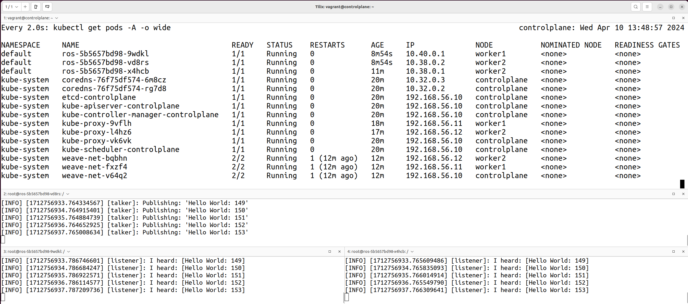

# ROS 2 on Kubernetes — Multi-Node Robotics Lab with Vagrant


**Vagrant-Kubernetes-ROS2-Deployment** is an open-source **ROS 2 on Kubernetes** educational lab. It uses **Vagrant and VirtualBox** to provision a local three-node Kubernetes cluster, with examples for ROS 2 DDS communication, workload scaling, Prometheus/Grafana monitoring, and Python/Jupyter metrics analysis.

**Who it is for:** ROS 2 and robotics developers, cloud-native engineers, students, and researchers exploring containerized robotics without a paid cloud account. **Why use it:** infrastructure scripts, ROS 2 container examples, monitoring configuration, and historical sample metrics are in one repository.

> **Compatibility and test status:** The **Vagrant/Kubernetes configuration and original root-level ROS manifests remain a historical ROS 2 Foxy / Kubernetes 1.29 / Weave Net lab**, **not a validated current-version or production deployment**. Foxy reached end of life in June 2023. The original Kubernetes workload manifests start `stress-ng`; the ROS 2 talker/listener example requires separate interactive commands and is **not** automatically launched by `vagrant up`. A **separate ROS 2 Jazzy / Ubuntu 24.04 container build and local message smoke test** now exist in [the Jazzy image guide](./ROS2/jazzy/README.md). This does **not** establish multi-node Kubernetes or DDS compatibility. Cross-worker integration remains tracked in [issue #14](https://github.com/MSKazemi/Vagrant-Kubernetes-ROS2-Deployment/issues/14).

**Explore:** [Jazzy image build and test](./ROS2/jazzy/README.md) · [Requirements](#prerequisites) · [Legacy Vagrant setup](#quickstart) · [Legacy ROS 2 tutorial](./ROS2/README.md) · [DDS networking guide](./docs/ROS2-KUBERNETES-DDS-GUIDE.md) · [Monitoring](./MonitoringSystem/README.md) · [Metrics analysis](./DataAnalysis/README.md) · [Good first issues](https://github.com/MSKazemi/Vagrant-Kubernetes-ROS2-Deployment/labels/good%20first%20issue)



> **New contributors welcome!** Choose a small [good first issue](https://github.com/MSKazemi/Vagrant-Kubernetes-ROS2-Deployment/labels/good%20first%20issue) or a [help-wanted task](https://github.com/MSKazemi/Vagrant-Kubernetes-ROS2-Deployment/labels/help%20wanted). Start with [CONTRIBUTING.md](./CONTRIBUTING.md), or follow the beginner-friendly [**Claude Code / Codex contribution tutorial**](./docs/AI_ASSISTED_CONTRIBUTING.md) and [ready-to-copy agent prompts](./docs/AGENT_PROMPTS.md). Using AI is optional; many starter tasks require only Markdown, Python, or GitHub Actions—not a 30 GB Vagrant setup.

## Table of Contents

- [ROS 2 on Kubernetes: Multi-Node Robotics Lab](#ros-2-on-kubernetes--multi-node-robotics-lab-with-vagrant)
  - [Table of Contents](#table-of-contents)
  - [Overview](#overview)
  - [Features](#features)
  - [Architecture](#architecture)
  - [Installation and Usage](#installation-and-usage)
    - [Prerequisites](#prerequisites)
      - [Installation of VirtualBox](#installation-of-virtualbox)
      - [Installation of Vagrant](#installation-of-vagrant)
  - [Quickstart](#quickstart)
  - [Project Structure](#project-structure)
    - [Kubernetes Cluster Setup](#kubernetes-cluster-setup)
    - [Network Configuration](#network-configuration)
    - [Monitoring System](#monitoring-system)
    - [ROS2 Deployment](#ros2-deployment)
    - [Data Analysis Tools](#data-analysis-tools)
      - [Historical component versions](#historical-component-versions-not-current-support-targets)
  - [Use Cases](#use-cases)
  - [FAQ](#faq)
  - [Citation](#citation)
    - [License](#license)
  - [Contributing](#contributing)
  - [Acknowledgments](#acknowledgments)

## Overview
The [Vagrantfile](./Vagrantfile) defines one Kubernetes control-plane VM and two worker VMs. Shell scripts configure a kubeadm-based Kubernetes cluster, deploy the historical Weave Net Container Network Interface (CNI), and install monitoring components. The [ROS 2 examples](./ROS2/) contain container images and manifests for learning how robotics software and Kubernetes scheduling interact.

**ROS 2 networking:** DDS (Data Distribution Service) provides publish/subscribe communication. How ROS 2 participants discover one another depends on the middleware implementation (RMW) and network configuration. The original lab chose Weave Net for multicast. **Multicast is not universally required by ROS 2:** [Fast DDS Discovery Server](https://fast-dds.docs.eprosima.com/en/latest/fastdds/ros2/discovery_server/ros2_discovery_server.html) supports explicit, server-based discovery. The current setup has not been revalidated on modern Kubernetes; see the [DDS and Kubernetes troubleshooting guide](./docs/ROS2-KUBERNETES-DDS-GUIDE.md) and [networking upgrade issue](https://github.com/MSKazemi/Vagrant-Kubernetes-ROS2-Deployment/issues/15).

**New to Kubernetes or ROS 2?** Check out our [Beginner Glossary](docs/GLOSSARY.md) to clarify the terminology used in this lab.

## Features
- **Three-node local Kubernetes cluster:** `vagrant up` defines three Ubuntu 22.04 VMs (one control plane plus two workers) with `kubeadm`.
- **ROS 2 images and experiments:** `ROS2/Dockerfile` now builds a digest-pinned **Jazzy/Ubuntu 24.04 container** with `demo_nodes_cpp` and `stress-ng`, with an automated **same-container** ROS message smoke test. The original Kubernetes manifests remain **legacy Foxy stress workloads** and do **not** automatically start a talker/listener.
- **DDS discovery study:** Weave Net networking configuration and a [guide to ROS 2 discovery across Kubernetes pods](./docs/ROS2-KUBERNETES-DDS-GUIDE.md). Cross-node communication must be verified for each environment.
- **Monitoring configuration:** Prometheus, Grafana, Kubernetes Dashboard, and Metrics Server scripts and persistent-storage examples from the original experiment.
- **Autoscaling and resource study:** HPA/VPA manifests and CPU/memory stress workloads (not a validated real-time robotics benchmark).
- **Historical datasets:** Prometheus sample metrics, Python analysis scripts, Jupyter notebooks, and plots.
- **Infrastructure as code:** Vagrant provisioning and shell scripts with historical version references. Some downloads are mutable/unpinned, so a fresh installation is **not guaranteed** to be reproducible.

## Architecture

The `Vagrantfile` defines a three-node cluster on a private VirtualBox network:

| Node | Role | IP | vCPUs | Memory |
|------|------|----|-------|--------|
| `controlplane` | Kubernetes control plane | 192.168.56.10 | 14 | ~18 GB |
| `worker1` | Worker node | 192.168.56.11 | 2 | ~6 GB |
| `worker2` | Worker node | 192.168.56.12 | 2 | ~6 GB |

The control plane is initialized with `kubeadm init --apiserver-advertise-address=192.168.56.10 --pod-network-cidr=10.244.0.0/16`; workers join automatically using a generated `kubeadm` join token. Resource sizing is defined in the `Vagrantfile` and can be adjusted to fit your host.

## Installation and Usage

### Prerequisites

Before beginning, ensure you have VirtualBox and Vagrant installed on your machine. Because the default cluster requests roughly **30 GB of RAM and 18 vCPUs** across the three VMs, a host with ample resources is recommended; reduce the `vb.memory` / `vb.cpus` values in the `Vagrantfile` for smaller machines.

#### Installation of VirtualBox

To install VirtualBox, run the following commands:

```bash
sudo apt update && sudo apt upgrade -y
sudo apt install virtualbox -y
```

Alternatively, you can download and install VirtualBox from the following link:
- https://www.virtualbox.org/wiki/Linux_Downloads
- https://download.virtualbox.org/virtualbox/7.0.14/virtualbox-7.0_7.0.14-161095~Ubuntu~jammy_amd64.deb

#### Installation of Vagrant

Install Vagrant with these commands:

```bash
sudo apt update && sudo apt upgrade -y
wget -O- https://apt.releases.hashicorp.com/gpg | sudo gpg --dearmor -o /usr/share/keyrings/hashicorp-archive-keyring.gpg
echo "deb [signed-by=/usr/share/keyrings/hashicorp-archive-keyring.gpg] https://apt.releases.hashicorp.com $(lsb_release -cs) main" | sudo tee /etc/apt/sources.list.d/hashicorp.list
sudo apt update && sudo apt install vagrant
```

Verify the installation:

```bash
vagrant --version
```

## Quickstart
**Historical installation example — not a verified modern quickstart.** This Vagrant configuration requests approximately **30 GB of VM RAM and 18 virtual CPUs**. Its older dependencies may require maintenance.

On your **host**:

```bash
git clone https://github.com/MSKazemi/Vagrant-Kubernetes-ROS2-Deployment.git
cd Vagrant-Kubernetes-ROS2-Deployment
vagrant up
vagrant ssh controlplane
```

Then, inside the **control-plane VM**, where `kubectl` is configured:

```bash
kubectl get nodes -o wide
kubectl get pods -A
```

For the existing **CPU stress/HPA experiment** (not an automatically started ROS 2 talker/listener):

```bash
kubectl apply -f /home/vagrant/codes/ROS2/ros_dep_1.yaml
kubectl -n ros get pods -o wide
kubectl -n ros scale deployment ros --replicas=3
```

To run a **manual ROS 2 talker/listener** demonstration, use the separate [ROS2/README.md](./ROS2/README.md) guide. Its outdated filename/namespace examples are being addressed in [issue #24](https://github.com/MSKazemi/Vagrant-Kubernetes-ROS2-Deployment/issues/24). Scaling the stress workload alone does not demonstrate DDS message delivery.

> **Do not share provisioning logs or kubeconfig files.** The original monitoring scripts may include privileged Kubernetes Dashboard tokens in terminal output. Credential/RBAC hardening is tracked in [issue #6](https://github.com/MSKazemi/Vagrant-Kubernetes-ROS2-Deployment/issues/6).

### Check status, stop, and remove the VMs

Run these on your **host**, from the repository directory:

```bash
vagrant status       # show the state of the three VMs (controlplane, worker1, worker2)
vagrant halt         # shut the VMs down and keep their disks
vagrant up           # start them again
vagrant destroy -f   # delete the VMs without asking for confirmation
```

> **Warning:** `vagrant destroy -f` permanently deletes the three VirtualBox VMs and everything stored inside them, including the Kubernetes cluster state and any Prometheus/Grafana data. It does not delete this repository folder, and the next `vagrant up` provisions the cluster from scratch.

## Project Structure

### Kubernetes Cluster Setup
Scripts and configurations to initialize a Kubernetes cluster. [More Details](./KubernetesClusterSetup/README.md)

- [Deploying a Kubernetes Cluster Using Vagrant and VirtualBox](./KubernetesClusterSetup/README.md#overview)
- [Pre-requisites and Dependencies](./KubernetesClusterSetup/README.md#prerequisites)
- [Cluster VM's Lifecycle Commands](./KubernetesClusterSetup/README.md)
- [Technical Details (Vagrantfile, Kubeadm, Kubectl, Kubelet, Container Network Interface Plugin)](./KubernetesClusterSetup/README.md)

### Network Configuration

Historical Weave Net setup and ROS 2 discovery guidance: [Network configuration](./Network/README.md) · [DDS across Kubernetes pods](./docs/ROS2-KUBERNETES-DDS-GUIDE.md)

- [VMs/Nodes Network Configuration](./Network/README.md)
- [Kubernetes Network Plugin - CNI Plugin Configuration](./Network/README.md)

### Monitoring System

Configuration files and scripts for setting up Prometheus, Grafana, and Kubernetes monitoring tools. [More Details](./MonitoringSystem/README.md)

- [Metrics Server](./MonitoringSystem/README.md)
- [Kubernetes Dashboard](./MonitoringSystem/README.md)
- [Dashboard Access and Security](./MonitoringSystem/README.md)
- [Prometheus and Grafana](./MonitoringSystem/README.md)
- [Helm](./MonitoringSystem/README.md)
- [Persistent Volume Configuration](./MonitoringSystem/README.md)
- [GUI Access URLs and Credentials](./MonitoringSystem/README.md)

### ROS2 Deployment

Deployment instructions and configurations for ROS2 Talker and Listener nodes. [More Details](./ROS2/README.md)

- [ROS2 (Robot Operating System 2)](./ROS2/README.md)
- [ROS2 Nodes vs. Kubernetes Nodes](./ROS2/README.md)
- [ROS2 Talker and Listener Nodes](./ROS2/README.md)
- [Deploying the ROS2 Nodes](./ROS2/README.md)
- [Testing the ROS2 Nodes](./ROS2/README.md)


### Data Analysis Tools

Python and Jupyter Notebook setups for analyzing data collected from the environment. [More Details](./DataAnalysis/README.md)

- [Data Extraction From Prometheus TSDB Databases](./DataAnalysis/README.md)
- [Using Python and Jupyter for Data Analysis](./DataAnalysis/README.md)


#### Historical component versions (not current support targets)

| Software             | Version      |
|----------------------|-------------|
| Ubuntu               | 22.04.4 LTS |
| Vagrant              | 2.4.1       |
| VirtualBox           | 7.0.14      |
| Kubernetes           | v1.29.4     |
| Kubeadm              | v1.29.4     |
| Kubectl              | v1.29.4     |
| kubelet              | v1.29.4     |
| Prometheus           | v2.51.1     |
| Grafana              | v10.4.1     |
| Dashboard            | v2.7.0      |
| Metrics Server       | v0.7.1      |
| Helm                 | v3.14.2     |
| Visual Studio Code   | v1.89.0     |

## Use Cases

- **Study ROS 2 on Kubernetes locally** without cloud costs, on a sufficiently resourced workstation.
- **Prototype and test** containerized robotics middleware and DDS communication patterns.
- **Study Kubernetes autoscaling** (HPA/VPA) and self-healing behavior under load with `stress-ng`.
- **Teach** cloud-native and robotics concepts with a reproducible, scripted environment.
- **Collect and analyze** cluster resource metrics (CPU, memory, network) from Prometheus using Python/Jupyter.

## FAQ
### Can you run ROS 2 on Kubernetes?

Yes, ROS 2 processes can run inside containers managed as Kubernetes pods. ROS 2 application nodes are different from Kubernetes worker nodes. This repository provides a historical, local environment to learn their interaction; it is **not** a production-ready ROS 2 orchestration platform.

### How do I deploy ROS 2 on Kubernetes locally using Vagrant?

Use the [historical Vagrant quickstart](#quickstart) to provision the local cluster, then follow the [ROS 2 tutorial](./ROS2/README.md). The default setup requires a powerful host, and a modern, lower-resource kind/k3d route is only [planned](https://github.com/MSKazemi/Vagrant-Kubernetes-ROS2-Deployment/issues/16).

### How does ROS 2 DDS discovery work between Kubernetes pods?

DDS discovery depends on RMW, discovery mode, networking, and participant configuration. Default multicast discovery is not assured by every Kubernetes CNI, while explicit discovery options such as Fast DDS Discovery Server can avoid multicast discovery. See [ROS 2 DDS across Kubernetes pods](./docs/ROS2-KUBERNETES-DDS-GUIDE.md). **This checkout does not include a validated modern cross-worker discovery test.**

### Does this project already work with ROS 2 Jazzy or a current Kubernetes release?

A **Jazzy/Ubuntu 24.04 container image recipe** is now available and checked by an image-local test (see [Jazzy guide](./ROS2/jazzy/README.md)). This is **not** proof of a modern Kubernetes lab: the Vagrant scripts still use **Kubernetes 1.29**, archived Weave Net, and old Foxy Kubernetes manifest references. See [modernization issue #7](https://github.com/MSKazemi/Vagrant-Kubernetes-ROS2-Deployment/issues/7).

### Does `ros_dep_1.yaml` run ROS 2 talker and listener automatically?

No. The manifest runs `stress-ng` as a CPU workload with an HPA. Running talker/listener requires separate manual commands (and verification), as explained in the [ROS 2 walkthrough](./ROS2/README.md). A tested automatic cross-worker demonstration is tracked in [issue #14](https://github.com/MSKazemi/Vagrant-Kubernetes-ROS2-Deployment/issues/14).

### Can I use Prometheus and Grafana to study Kubernetes autoscaling?

The repository contains monitoring manifests, historical scripts, Jupyter notebooks, and sample CPU/memory/network data. These are useful as educational examples, but the datasets are **not** proof of a new benchmark run or current-cluster compatibility. Start with [MonitoringSystem](./MonitoringSystem/README.md) and [DataAnalysis](./DataAnalysis/README.md).

### Is it free, open source, or intended for production robots?

The repository is open source under [Apache-2.0](./LICENSE) and uses local virtual machines, so it does not require a cloud subscription. It **is not intended for production robotics, safety-critical control, or real-time guarantees**. Version maintenance, safe permissions, and end-to-end validation remain outstanding.

## Related ROS 2 / Kubernetes resources

- [ROS 2 official documentation](https://docs.ros.org/en/rolling/) — middleware, packages and supported distributions.
- [ROS/Kubernetes and KubeEdge examples (fujitatomoya/ros_k8s)](https://github.com/fujitatomoya/ros_k8s) — broader set of ROS 2 cluster deployment tutorials.
- [RobotKube (RWTH Aachen)](https://github.com/ika-rwth-aachen/robotkube) — research on orchestration of cooperative multi-robot systems.

## Citation
If you use this project or its components in your research or in developing software, we kindly request that you cite it. Here's a suggested citation format:

```bibtex
@misc{Vagrant-Kubernetes-ROS2,
  author = {Mohsen Seyedkazemi Ardebili},
  title = {Vagrant-Kubernetes-ROS2 Deployment},
  year = {2024},
  publisher = {GitHub},
  howpublished = {\url{https://github.com/MSKazemi/Vagrant-Kubernetes-ROS2-Deployment}}
}
```

### License

Distributed under the Apache License 2.0. See [LICENSE](./LICENSE) for more information.

## Contributing
We welcome first-time contributors, educators, ROS 2 users and Kubernetes engineers. The easiest place to start is a labeled [good first issue](https://github.com/MSKazemi/Vagrant-Kubernetes-ROS2-Deployment/labels/good%20first%20issue), or a scoped [help wanted issue](https://github.com/MSKazemi/Vagrant-Kubernetes-ROS2-Deployment/labels/help%20wanted). Read the [contribution guide](./CONTRIBUTING.md) or the [Claude Code/Codex step-by-step guide](./docs/AI_ASSISTED_CONTRIBUTING.md) before claiming a task or opening a PR. Documentation and simple static-check contributions do not require VirtualBox or a running Kubernetes cluster.

Everyone taking part is expected to follow the [Code of Conduct](./CODE_OF_CONDUCT.md). Contributors are thanked in [CONTRIBUTORS.md](./CONTRIBUTORS.md), and security problems should be reported privately as described in [SECURITY.md](./SECURITY.md).

## Acknowledgments
- Kubernetes
- Vagrant
- VirtualBox
- Prometheus
- Grafana
- ROS2

Thank you for exploring our Vagrant-Kubernetes-ROS2 Deployment repository. Dive into each component for a deeper understanding and more detailed documentation!
